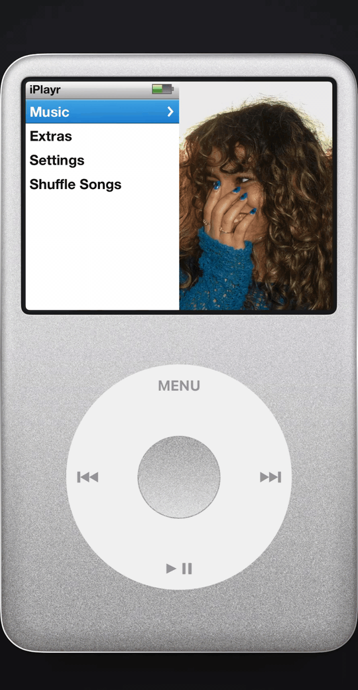
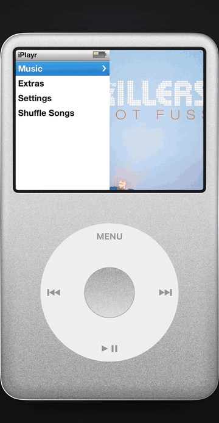

# iPlayr

A faithful iPod classic recreation for iOS, built entirely in SwiftUI on top of Apple Music.

Not an iPod-*inspired* player: the click wheel drives every interaction, the menu keeps its
split-screen artwork pane, and the interface colours are sampled from the original iPod artwork
rather than eyeballed.

[](https://developer.apple.com/ios/)
[](https://swift.org)

<div align="center">
  
  
  
  
</div>

<div align="center">
  
</div>

## Features

- **Click wheel** — rotate your thumb to scroll, with selection haptics and the original click
  sound. MENU goes back one screen; hold it to jump to the main menu.
- **Split-screen menus** — the artwork pane on the right slowly pans through your album covers,
  just like the 6th generation did.
- **Cover Flow** — flick through your albums in 3D and flip a cover to see its tracks.
- **Now Playing** — scrubbing progress, track skipping, and press-and-hold seeking. Once music is
  playing, a *Now Playing* row appears in the menus to take you back to it.
- **Themes** — silver, black and U2 Special Edition.
- **Your Apple Music library** — albums, playlists and their tracks.

## Requirements

- Xcode 16 or later
- iOS 17.0+
- An active Apple Music subscription
- A physical device is recommended — music playback and battery reporting are limited in the
  simulator

## Getting started

```bash
git clone https://github.com/keremersu35/iPodPlayer.git
cd iPodPlayer/iPlayr
open iPlayr.xcodeproj
```

Set your own signing team, then run. On first launch the app asks for Apple Music access — grant it
from the Sign In menu entry.

## Contributing

Issues and pull requests are welcome. Please keep changes focused and match the surrounding style.

## Credits

The Now Playing shuffle, repeat and volume bitmaps come from the iPod classic firmware, via the
[osos-lab / RepriseOS](https://github.com/lgreitis/osos-lab) project (GPL-3.0). The original artwork is © Apple Inc.
